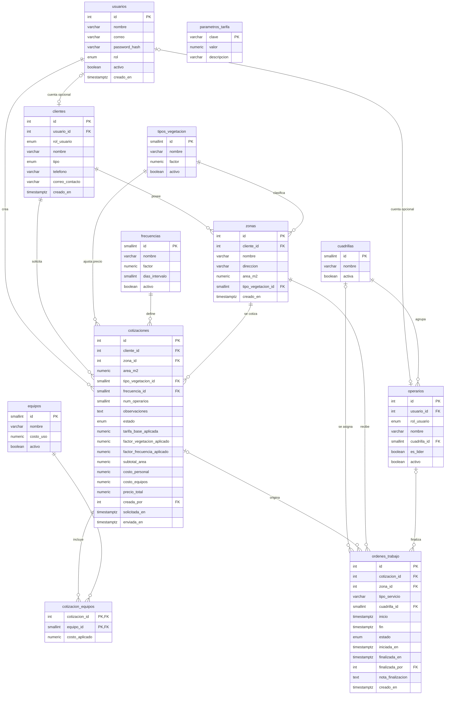

# Diagrama entidad-relación — DPM S.A.S. (Corte 2)

Diagrama **renderizable en GitHub** que representa las 12 tablas diseñadas en `01_schema.sql`. Las etiquetas PK/FK son orientativas; las definiciones SQL son la fuente de verdad para restricciones, índices y claves compuestas.

## Notas de integridad importantes

- `cotizaciones(zona_id, cliente_id)` referencia de manera **compuesta** `zonas(id, cliente_id)`, asegurando que la zona cotizada pertenece al cliente.
- `clientes(usuario_id, rol_usuario)` y `operarios(usuario_id, rol_usuario)` usan claves compuestas sobre `usuarios(id, rol)` para validar el perfil.
- `cotizacion_equipos` posee clave primaria compuesta `(cotizacion_id, equipo_id)`.
- Solo un operario puede marcarse líder por cuadrilla; la restricción usa un índice único parcial.
- El esquema impide cruces horarios de una misma cuadrilla mediante un trigger y mantiene controles de estados y finalización.

Este artefacto es **documentación de diseño**, no evidencia de que el prototipo frontend ya esté conectado a PostgreSQL. Las tarifas y los datos semilla se consideran ficticios hasta validación con DPM S.A.S.
