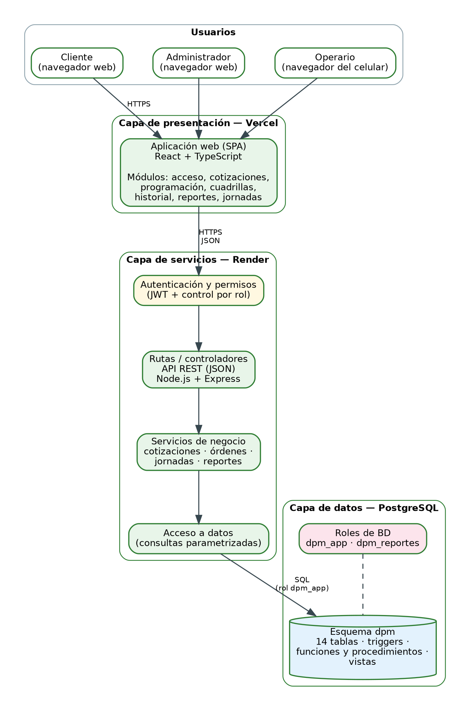

# Arquitectura del sistema — DPM SAS

Documento de diseño del Trabajo de Grado I (corte 2, objetivo específico 2). Describe la arquitectura prevista del sistema de información web para la gestión de cotizaciones, programación de servicios y control de jornadas de DPM SAS, y el estado real de cada componente.

## 1. Estado actual y previsto

| Componente | Estado |
|---|---|
| Aplicación web (React + TypeScript) | **Prototipo** con datos simulados en `src/`; cubre 12 de 19 pantallas identificadas |
| Base de datos PostgreSQL (esquema `dpm`) | **Construida y probada** (carpeta `database/`, 18 pruebas, 27 comprobaciones) |
| API REST (Node.js + Express) | **Diseñada**; no implementada |
| Autenticación (JWT) y permisos por rol | **Diseñada**; no implementada |
| Integración API–base de datos | **Diseñada**; no implementada |
| Despliegue (Vercel, Render y PostgreSQL gestionado) | **Previsto**; falta elegir la base de datos gestionada |

> La API Express y la integración con PostgreSQL no deben describirse como implementadas hasta comprobarlo.

## 2. Arquitectura en capas

- **Presentación.** Aplicación de una sola página (React + TypeScript) desplegada en Vercel. Se usa desde el navegador de escritorio o del celular (RNF-01).
- **Servicios.** API REST (Node.js + Express) desplegada en Render. Un middleware autentica con JWT y verifica el permiso del rol antes de cada operación. Las rutas delegan en servicios de negocio (cotizaciones, órdenes, jornadas y reportes), que acceden a los datos con consultas parametrizadas.
- **Datos.** PostgreSQL. La API se conecta con el rol `dpm_app`; los reportes pueden usar `dpm_reportes` (solo lectura de vistas). Las reglas críticas (precio fijo, hitos de pago, cruce de horarios y conciliación de planillas) también se verifican en la base de datos.

## 3. Ejemplo de flujo de una petición

1. El administrador envía una cotización desde la aplicación web.
2. La aplicación llama `POST /cotizaciones/{id}/enviar` con el token del usuario.
3. El middleware valida el token y comprueba que el rol sea administrador.
4. El servicio ejecuta `CALL sp_enviar_cotizacion(id)`.
5. La base de datos valida que exista visita técnica y líneas, y que los hitos sumen 100 %; luego marca la cotización como enviada, con precio fijo.
6. Si una regla falla, la API responde `422` con el motivo y la aplicación lo muestra al usuario.

## 4. Requisitos no funcionales

| RNF | Cómo se atiende |
|---|---|
| RNF-01 Acceso multiplataforma | Aplicación web responsiva; verificación en navegadores de escritorio y móvil durante la implementación |
| RNF-02 Cifrado de datos personales | Contraseñas como hash; HTTPS en el despliegue; solo se almacenan los datos necesarios (Ley 1581 de 2012) |
| RNF-03 Tiempo de respuesta | Índices en las consultas frecuentes; plan de pruebas de desempeño (apartado 3.8.9 del documento) |
| RNF-04 Control de acceso por perfil | Permisos por rol en la API y roles de privilegios mínimos en la base de datos |

## 5. Seguridad y protección de la información

- Las contraseñas se almacenan como hash (por ejemplo, bcrypt); nunca en texto plano.
- Los usuarios se desactivan (`activo = false`) en lugar de borrarse; las cotizaciones enviadas no se modifican.
- El perfil `dpm_reportes` no puede leer `usuarios` ni el análisis interno de costos (verificado en la prueba C16).
- Los datos de prueba son ficticios y las evidencias de la empresa se usan anonimizadas, con el consentimiento de DPM SAS (carta del Apéndice A del documento).
- Pendiente: HTTPS en el despliegue y política de copias de seguridad.

## 6. Limitaciones y pendientes

- Las tarifas, los valores en pesos y las unidades de cobro son ilustrativos hasta validarlos con DPM SAS.
- El perfil del responsable de campo dentro del sistema está por validar.
- Falta elegir el servicio de PostgreSQL gestionado para el despliegue.