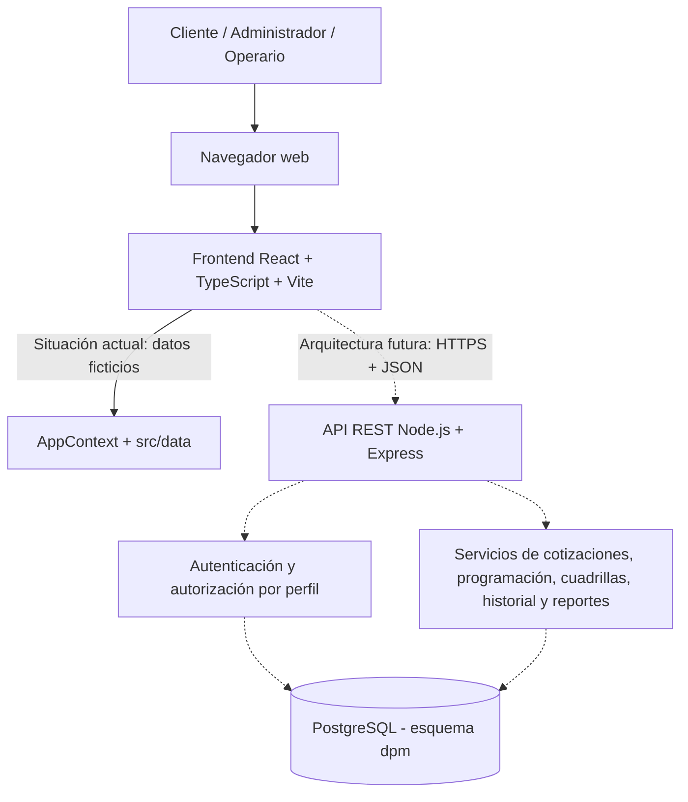

# Arquitectura del sistema — DPM S.A.S.

**Proyecto:** Sistema web para la gestión de cotizaciones y mantenimiento de zonas verdes.  
**Etapa:** Trabajo de Grado I, corte 2, objetivo específico 2.  
**Metodología aprobada:** Scrum.  
**Autores:** Jorge Luis Ramos Perdomo y Richard Esteban Sevillano Cuaran.

## 1. Propósito y alcance

Documentar la estructura lógica, las responsabilidades, la persistencia, los flujos e interfaces del sistema, asegurando trazabilidad con las historias de usuario HU-01 a HU-08 y los requisitos no funcionales RNF-01 a RNF-04. La entrega del corte 2 se centra en **diseñar** la solución y construir/comprobar su base de datos, no en terminar todos los módulos de la aplicación.

## 2. Estado verificable de los componentes

| Componente | Tecnología | Estado de la evidencia |
| --- | --- | --- |
| Interfaz y navegación por perfiles | React, TypeScript, Vite, React Router, Tailwind CSS | Presente en `src/` como prototipo navegable |
| Datos de interfaz, cotizaciones y órdenes | `src/data/` y estado React en `src/context/AppContext.tsx` | Simulados en el navegador; sin persistencia en PostgreSQL |
| Inicio de sesión y permisos del frontend | Componentes de rutas y estado del contexto | Solo demostración; **no es autenticación/autorización real** |
| API de negocio | Node.js + Express, JSON sobre HTTPS | Arquitectura **propuesta**, no verificada como implementada en este repositorio |
| Base de datos | PostgreSQL 14+, esquema `dpm` | Scripts, ER, diccionario y resultados de comprobación aportados en `database/` |
| Hosting del frontend y API | Vercel y Render | Opciones **previstas**, no evidenciadas como desplegadas |

## 3. Vista de arquitectura lógica



**Convención:** las líneas continuas representan el prototipo actual; las líneas discontinuas, componentes o conexiones previstos para implementación posterior.

## 4. Responsabilidades de los módulos propuestos

| Módulo | HU/RNF | Responsabilidad | Persistencia diseñada |
| --- | --- | --- | --- |
| Cuentas y acceso | RNF-02, RNF-04 | Identidad, acceso por rol, validación y controles de seguridad | `usuarios`, `clientes`, `operarios` |
| Clientes y zonas | HU-02, HU-07 | Catálogo de clientes y predios/zonas verdes | `clientes`, `zonas` |
| Cotizaciones | HU-01, HU-02 | Solicitud, factores, costo de personal/equipos, cálculo y estados | `cotizaciones`, `cotizacion_equipos`, `equipos`, `tipos_vegetacion`, `frecuencias`, `parametros_tarifa` |
| Programación | HU-03 | Órdenes, fechas, horarios y prevención de cruces | `ordenes_trabajo`, `cuadrillas` |
| Asignación de cuadrillas | HU-04, HU-05 | Asociar cuadrilla y visualizar órdenes pertinentes | `cuadrillas`, `operarios`, `ordenes_trabajo` |
| Ejecución e historial | HU-06, HU-07 | Cambios de estado, responsable, fecha, hora y consulta del historial | `ordenes_trabajo`, vistas de historial |
| Reportes | HU-08 | Indicadores y filtros por fechas/cliente | función `fn_reporte_periodo` y vistas de consulta |

La distribución definitiva y las reglas de precios deben contrastarse con la entrevista y documentos reales de DPM S.A.S. Los datos de `02_seed.sql` son ficticios y las tarifas, ilustrativas.

## 5. Flujo principal propuesto

1. El cliente o administrador identifica una zona y crea una solicitud de cotización (HU-02).
2. El administrador calcula el precio con área, vegetación, frecuencia, personal y equipos; el registro conserva los valores aplicados (HU-01).
3. Tras la aceptación, se programa una orden y se evita superposición de horarios de la cuadrilla (HU-03).
4. Se asigna cuadrilla; el operario ve las órdenes pertinentes (HU-04 y HU-05).
5. El operario informa finalización con fecha, hora y responsable (HU-06).
6. El cliente consulta el historial y el administrador obtiene reportes (HU-07 y HU-08).

Los pasos anteriores son el **diseño esperado**; no implican que ya exista una API o que el frontend consuma PostgreSQL.

## 6. Persistencia y reconstrucción

La documentación de `database/` incluye el diagrama ER, diccionario de datos, `01_schema.sql` (tablas, funciones, restricciones, índices, vistas y permisos), `02_seed.sql` (datos de prueba) y `03_consultas_comprobacion.sql` (pruebas). `prueba_salida.txt` contiene la ejecución registrada.

```bash
createdb dpm_sas
psql -d dpm_sas -v ON_ERROR_STOP=1 -f database/01_schema.sql
psql -d dpm_sas -v ON_ERROR_STOP=1 -f database/02_seed.sql
psql -d dpm_sas -v ON_ERROR_STOP=1 -f database/03_consultas_comprobacion.sql
```

**Advertencia:** `01_schema.sql` elimina y recrea el esquema `dpm`. Usar **solo en desarrollo o una base dedicada a pruebas**.

## 7. Diseño de seguridad

- El backend deberá verificar identidad y permisos del lado del servidor: las rutas protegidas de React solo sirven como comportamiento de interfaz.
- Las contraseñas reales deben almacenarse como hashes seguros con sal (por ejemplo, bcrypt o Argon2), nunca en texto plano. Los marcadores del seed no son contraseñas reales.
- El servidor deberá comprobar propiedad del cliente sobre cada zona/cotización y pertenencia del operario a su cuadrilla antes de atender solicitudes.
- Usar HTTPS en despliegue; credenciales de base de datos solo mediante variables de entorno del servidor, jamás en código cliente.
- Aplicar privilegios mínimos al usuario de PostgreSQL y controles para la consulta de datos personales, según RNF-02/RNF-04.
- Obtener aval y autorización para cualquier dato privado de DPM; las pruebas usan datos ficticios hasta validar con información real autorizada.

## 8. Evidencias y pendientes

**Disponibles:** navegación por perfiles, pantallas del prototipo, esquema relacional, diccionario, consultas y resultados de pruebas SQL.  
**Pendientes de validación:** reglas de negocio/tarifas con DPM, entrevista/documentación empresarial, contratos detallados de endpoints, autenticación segura, integración API–BD–frontend, despliegue y pruebas end-to-end. No presentar estas actividades pendientes como implementadas.

**Complementos:** [Diagrama de componentes](./diagrama-componentes.md), [Decisiones técnicas](./decisiones-tecnicas.md), [Base de datos](../../database/README.md).
