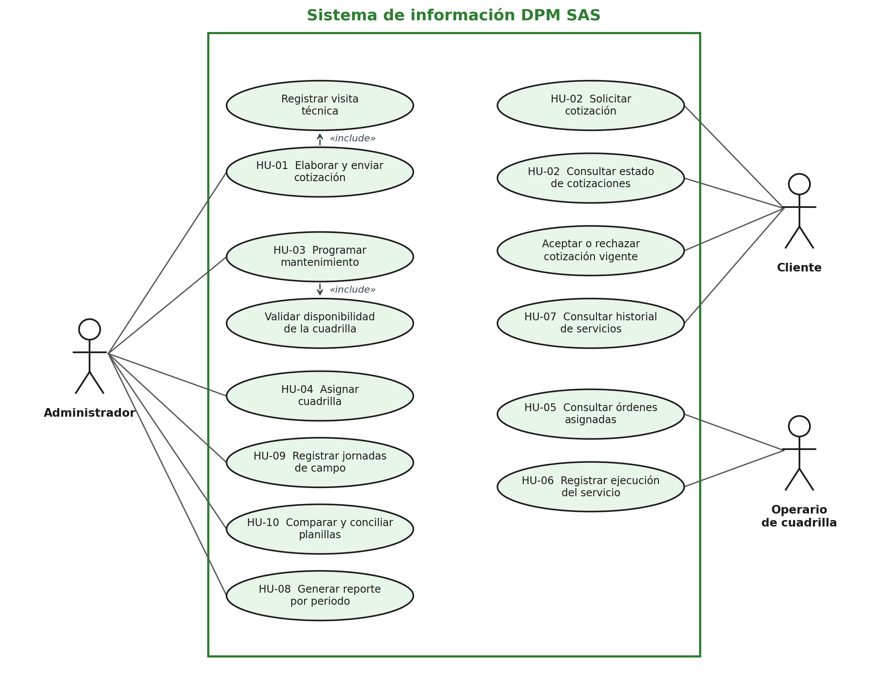
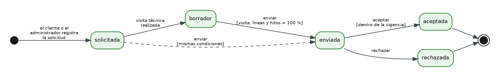
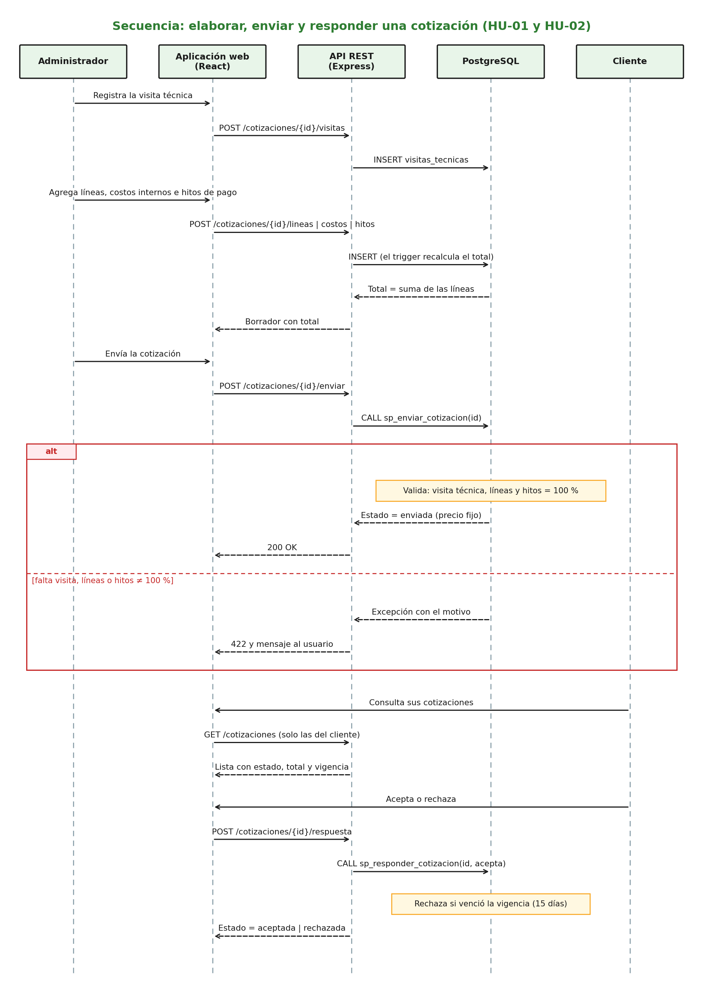
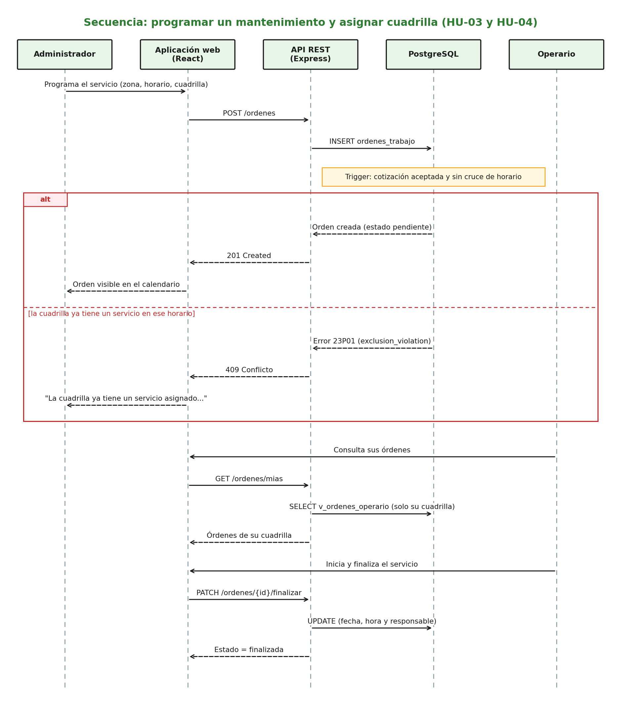
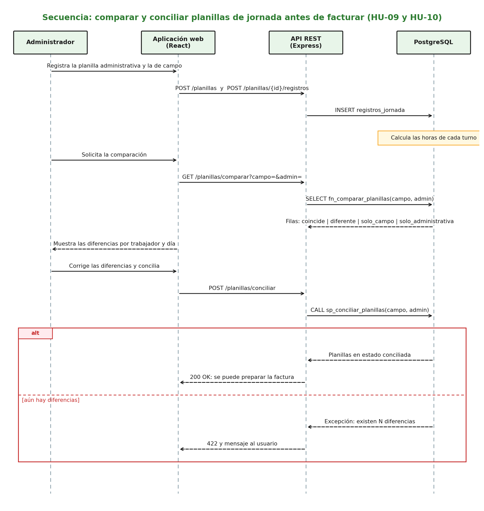
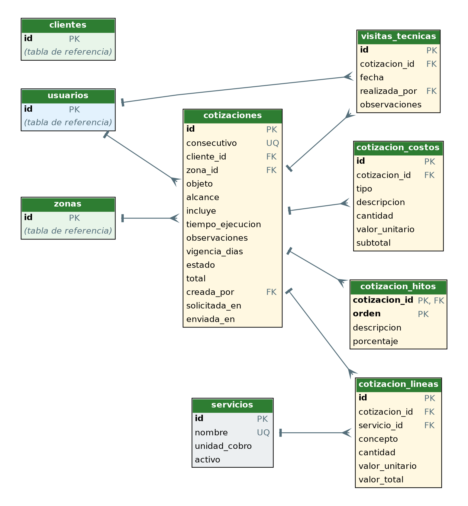
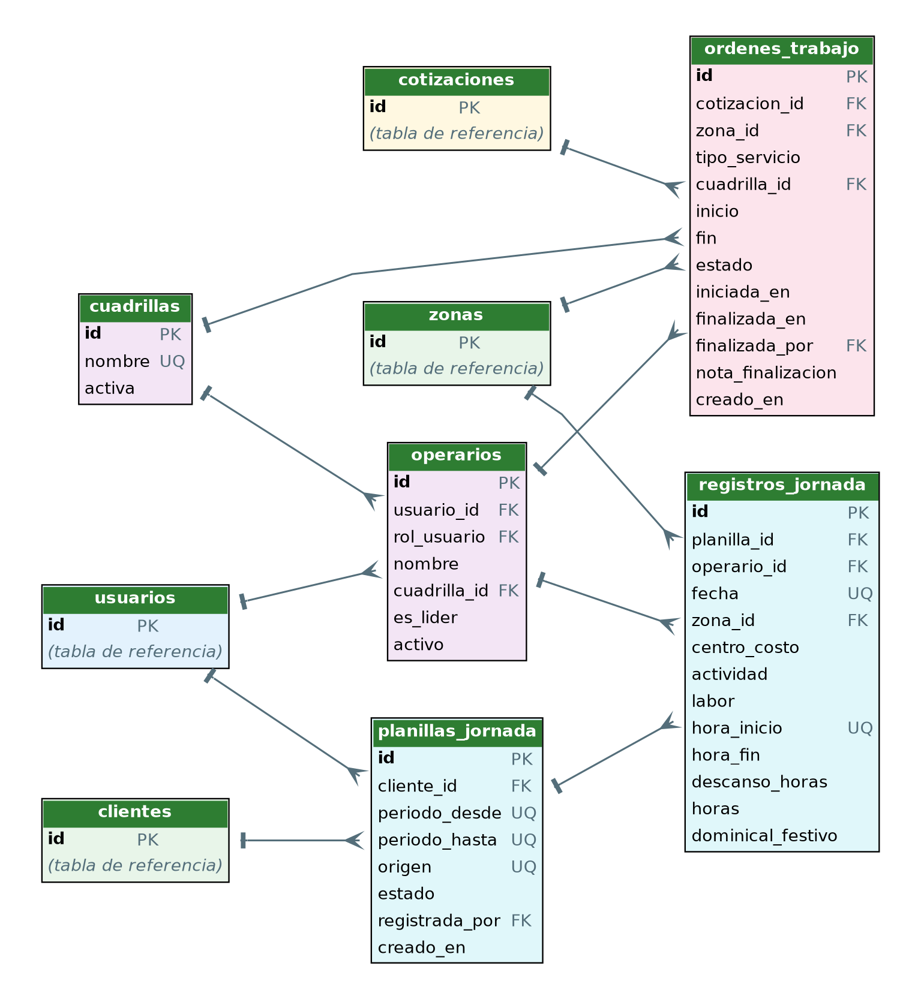

# Componentes, API y modelos UML — DPM SAS

## 1. Componentes por módulo

| Módulo | Aplicación web | API (recursos) | Base de datos |
|---|---|---|---|
| Acceso y usuarios | Inicio de sesión | `POST /auth/login` | `usuarios`, `clientes`, `operarios` |
| Cotizaciones | Solicitar, Mis cotizaciones, Cotizaciones, Nueva cotización | `/cotizaciones/...` | `cotizaciones`, `visitas_tecnicas`, `cotizacion_lineas`, `cotizacion_costos`, `cotizacion_hitos` |
| Programación | Calendario semanal y mensual | `/ordenes` | `ordenes_trabajo` |
| Cuadrillas | Disponibilidad y asignación | `/cuadrillas`, `PATCH /ordenes/{id}` | `cuadrillas`, `operarios` |
| Ejecución en campo | Mis órdenes, detalle y finalización | `/ordenes/mias`, `/ordenes/{id}/iniciar`, `/finalizar` | `ordenes_trabajo`, `v_ordenes_operario` |
| Historial | Historial de servicios | `GET /clientes/{id}/historial` | `v_historial_servicios` |
| Reportes | Reporte por periodo (pendiente) | `GET /reportes/periodo` | `fn_reporte_periodo` |
| Control de jornadas | Planillas y comparación (pendiente) | `/planillas/...` | `planillas_jornada`, `registros_jornada`, `fn_comparar_planillas`, `sp_conciliar_planillas` |

## 2. Recursos propuestos de la API

| Método y ruta | Rol | Historia | Objeto de base de datos |
|---|---|---|---|
| `POST /auth/login` | Público | RNF-04 | `usuarios` |
| `POST /cotizaciones` | Cliente, administrador | HU-02 | `cotizaciones` |
| `GET /cotizaciones`, `GET /cotizaciones/{id}` | Cliente (propias), administrador | HU-02 | `v_cotizaciones_detalle` |
| `POST /cotizaciones/{id}/visitas` | Administrador | HU-01 | `visitas_tecnicas` |
| `POST /cotizaciones/{id}/lineas` | Administrador | HU-01 | `cotizacion_lineas` |
| `POST /cotizaciones/{id}/costos` | Administrador | HU-01 | `cotizacion_costos` |
| `POST /cotizaciones/{id}/hitos` | Administrador | HU-01 | `cotizacion_hitos` |
| `POST /cotizaciones/{id}/enviar` | Administrador | HU-01 | `sp_enviar_cotizacion` |
| `POST /cotizaciones/{id}/respuesta` | Cliente | HU-02 | `sp_responder_cotizacion` |
| `POST /ordenes` | Administrador | HU-03 | `ordenes_trabajo` |
| `PATCH /ordenes/{id}` (asignar cuadrilla) | Administrador | HU-04 | `ordenes_trabajo` |
| `GET /cuadrillas` | Administrador | HU-04 | `cuadrillas`, `operarios` |
| `GET /ordenes/mias` | Operario | HU-05 | `v_ordenes_operario` |
| `PATCH /ordenes/{id}/iniciar`, `/finalizar` | Operario | HU-06 | `ordenes_trabajo` |
| `GET /clientes/{id}/historial` | Cliente (propio), administrador | HU-07 | `v_historial_servicios` |
| `GET /reportes/periodo` | Administrador | HU-08 | `fn_reporte_periodo` |
| `POST /planillas`, `POST /planillas/{id}/registros` | Administrador | HU-09 | `planillas_jornada`, `registros_jornada` |
| `GET /planillas/comparar` | Administrador | HU-10 | `fn_comparar_planillas` |
| `POST /planillas/conciliar` | Administrador | HU-10 | `sp_conciliar_planillas` |

## 3. Casos de uso

## 4. Estados de la cotización

## 5. Diagramas de secuencia

**Elaborar, enviar y responder una cotización (HU-01 y HU-02)**

**Programar un mantenimiento y registrar su ejecución (HU-03 a HU-06)**

**Comparar y conciliar planillas de jornada (HU-09 y HU-10)**

## 6. Modelo de datos

El diccionario completo está en [`database/diccionario_datos.md`](../../database/diccionario_datos.md).

## 7. Trazabilidad

| HU | Recurso de la API | Objetos de base de datos | Prueba |
|---|---|---|---|
| HU-01 | `/cotizaciones/{id}/visitas`, `/lineas`, `/costos`, `/hitos`, `/enviar` | `cotizaciones`, `visitas_tecnicas`, `cotizacion_lineas`, `cotizacion_costos`, `cotizacion_hitos`, `sp_enviar_cotizacion` | C1, C2, C4 |
| HU-02 | `POST/GET /cotizaciones`, `/respuesta` | `v_cotizaciones_detalle`, `sp_responder_cotizacion` | C3 |
| HU-03 | `POST /ordenes` | `ordenes_trabajo`, `trg_ordenes_validar` | C5, C6, C7 |
| HU-04 | `GET /cuadrillas`, `PATCH /ordenes/{id}` | `cuadrillas`, `operarios`, `v_ordenes_detalle` | C8 |
| HU-05 | `GET /ordenes/mias` | `v_ordenes_operario` | C10 |
| HU-06 | `PATCH /ordenes/{id}/iniciar`, `/finalizar` | `ordenes_trabajo` | C9 |
| HU-07 | `GET /clientes/{id}/historial` | `v_historial_servicios` | C11 |
| HU-08 | `GET /reportes/periodo` | `fn_reporte_periodo` | C15 |
| HU-09 | `POST /planillas`, `/registros` | `planillas_jornada`, `registros_jornada` | C12 |
| HU-10 | `GET /planillas/comparar`, `POST /planillas/conciliar` | `fn_comparar_planillas`, `sp_conciliar_planillas` | C13, C14 |