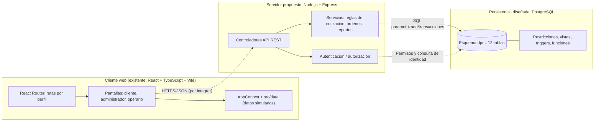
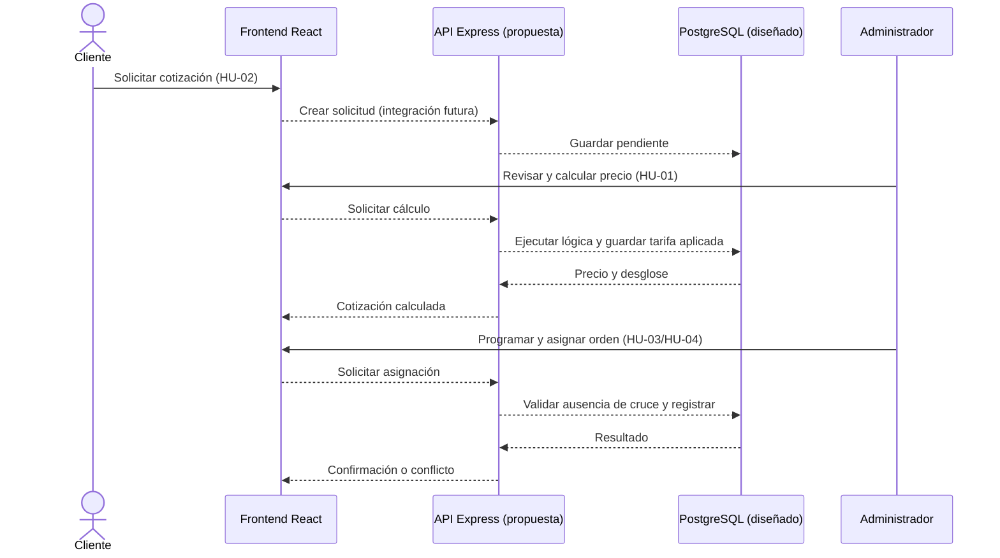

# Diagramas de componentes y relaciones — DPM S.A.S.

**Alcance:** arquitectura diseñada para el corte 2 de Trabajo de Grado I. Diferenciar implementación actual y componentes planificados. El diagrama ER de la persistencia está en [database/diagrama_er.md](../../database/diagrama_er.md). La imagen PNG aportada se conserva fuera del repositorio y no forma parte de esta entrega.

## 1. Componentes y dependencias

**Convención:** flechas discontinuas = integración futura. Los datos simulados y el estado local actuales no representan persistencia real.

## 2. Secuencia prevista: cotización y programación

El comportamiento SQL relevante existe en los scripts aportados. Esta secuencia no constituye evidencia de que los endpoints estén codificados.

## 3. Modelo de datos

- Ver [diagrama ER en Mermaid](../../database/diagrama_er.md), basado en las 12 tablas del esquema SQL.
- Ver `database/diccionario_datos.md` para 12 tablas y sus atributos.
- Ver `database/01_schema.sql` como definición autoritativa de claves foráneas, `CHECK`, índices, vistas, procedimientos y políticas del esquema.

**Nota de revisión:** se corrigieron las referencias de `cotizaciones.cliente_id` y `cotizaciones.zona_id` en el diccionario. El esquema SQL define conjuntamente `FOREIGN KEY (zona_id, cliente_id) REFERENCES zonas(id, cliente_id)`.

## 4. Matriz rápida de trazabilidad

| Requisito | Pantalla o comportamiento | Componente previsto | Evidencia de persistencia |
| --- | --- | --- | --- |
| HU-01 | Cotizaciones / nueva cotización | Servicio de cotizaciones | `cotizaciones`, cálculo de precio |
| HU-02 | Solicitar / mis cotizaciones | Servicio de clientes y solicitudes | `clientes`, `zonas`, `cotizaciones` |
| HU-03 | Programación | Servicio de órdenes | `ordenes_trabajo`, control de cruce |
| HU-04 | Asignar cuadrillas | Servicio de asignaciones | `cuadrillas`, `ordenes_trabajo` |
| HU-05 | Mis órdenes | Servicio de órdenes de operario | vista `v_ordenes_operario` |
| HU-06 | Finalizar orden | Servicio de ejecución | restricciones y validaciones de `ordenes_trabajo` |
| HU-07 | Historial | Servicio de historial | vista `v_historial_servicios` |
| HU-08 | Reporte por periodo | Servicio de reportes | función `fn_reporte_periodo` |
| RNF-02/RNF-04 | Acceso y datos protegidos | AuthN/AuthZ del servidor | hashes previstos, roles y permisos SQL |

La trazabilidad de diseño debe revisarse tras la entrevista con DPM y anexarse al informe académico.
